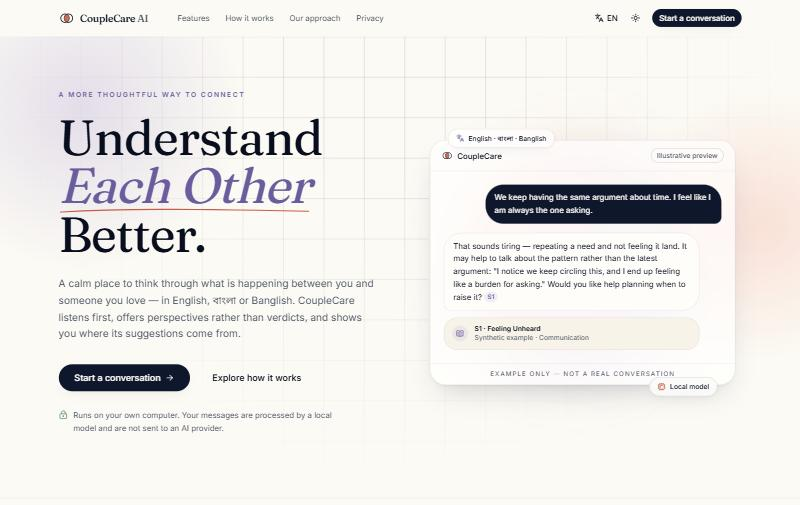
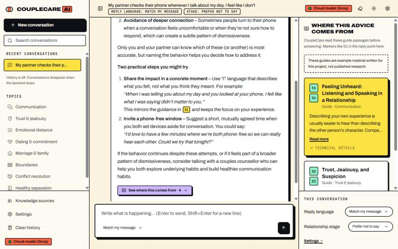
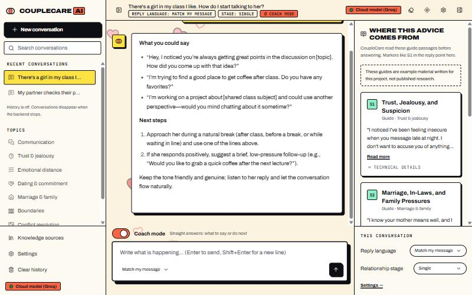
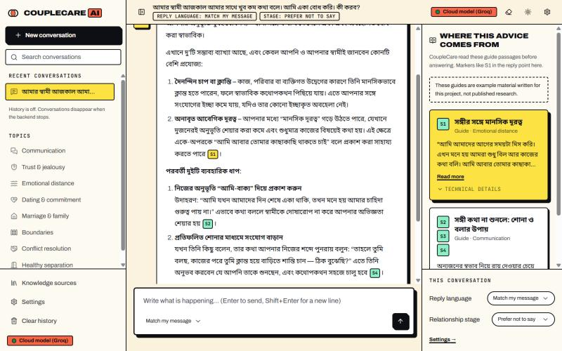
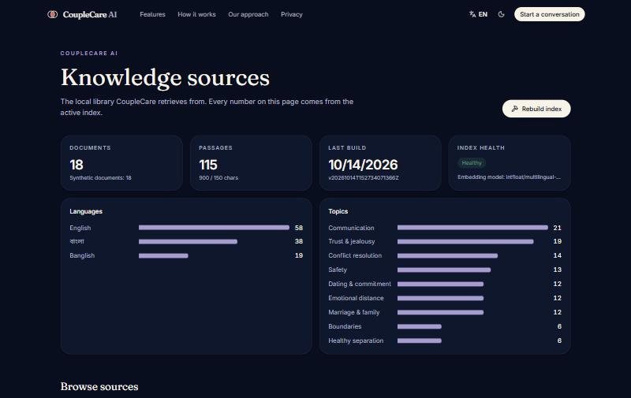

# CoupleCare AI

**Understand Each Other Better.** A private, bilingual (English · বাংলা · Banglish)
relationship-support assistant that runs entirely on your own computer, using a local language
model and retrieval-augmented generation (RAG) with source citations and an independent safety layer.

> CoupleCare offers educational support. It is not therapy, diagnosis, legal advice or a crisis
> service. If you are in immediate danger, contact your local emergency number.



| Normal reply — sources in the side panel | Coach mode — what to say next (stage: Single) |
|---|---|
|  |  |

| Bangla reply | Knowledge base (dark theme) |
|---|---|
|  |  |

_Screenshots of the real app (2026-10-16). The chat screenshots were taken in optional cloud mode (Groq `openai/gpt-oss-120b`, note the “Cloud model (Groq)” badge); the default local mode uses Qwen3-4B on the RTX 4060. The knowledge base is the bundled synthetic development corpus. The coach-mode screenshot was taken before the dating guides were added (its side panel lists older guides); replies to that question now draw on the new “Meeting Someone and Starting a Conversation” guide._

## Status (2026-10-15)

| Area | State |
|---|---|
| Landing, chat, settings, knowledge, about/privacy/safety pages | Implemented; tested with Vitest + axe-core; checked in the browser at desktop and phone widths, light and dark |
| FastAPI backend, hybrid RAG, citations, safety layer, storage | Implemented; 268 backend + 33 frontend tests passing (+4 real-model integration tests); CI on GitHub (Linux) green |
| Local generation | **Running on the RTX 4060**: Qwen3-4B-Instruct-2507 Q4_K_M via llama.cpp b11603 (CUDA), ~80 tokens/s, ~3.8 GB VRAM at 8k context |
| End-to-end in English, Bangla, Banglish | Verified in the UI with streaming, citations and safety routing |
| Safety | Rules + cues + semantic (E5) classifier; output filters (invented numbers, diagnoses, excusing abuse); pre-written support replies in Bangla/Banglish; held-out test: direct 15/15, indirect 5/5, false alarms 1/94 |
| Evaluation | 386 fictional scenarios (silver labels); retrieval, safety, A–D generation, prompt ablations and a second generator (Qwen3.5-4B) measured with 95% intervals — see [research/results_log.md](research/results_log.md). Blind human-annotation pack ready; no human labels yet |

Full report: [docs/status-report.md](docs/status-report.md).

**Known weak spots** (measured, not guessed): Banglish answers are the least fluent; Bangla and
Banglish retrieval ranks the right document lower than English; the knowledge base is synthetic;
all evaluation data is single-author and not yet human-annotated.

## System requirements

- Windows 11 (macOS/Linux work with equivalent commands), Python 3.11+ (tested 3.12.10), Node.js 20+ (tested 24.15)
- ~6 GB free disk on the drive holding the project (dependencies ≈ 2 GB, embedding model ≈ 0.5 GB,
  GGUF ≈ 2.5 GB, llama.cpp CUDA ≈ 0.7 GB). All downloads and caches (pip, npm, Hugging Face) are
  kept inside the project folder (`.cache/`, `models/`), not on the system drive.
- Recommended: NVIDIA GPU with 8 GB VRAM (target: RTX 4060 Laptop). CPU-only also works, slowly.

## Install (PowerShell)

```powershell
git clone https://github.com/souwmo04/Couple-Care-AI-Rag-Model.git
cd Couple-Care-AI-Rag-Model
powershell -ExecutionPolicy Bypass -File scripts\setup.ps1
```

`setup.ps1` creates `.venv`, installs **CPU-only PyTorch** (so the GPU stays free for the
language model), installs pinned backend and frontend dependencies, and copies `.env.example` to `.env`.

## Download the local model

```powershell
scripts\download-model.ps1              # llama.cpp b11603 (CUDA 12.4) + Qwen3-4B-Instruct-2507 Q4_K_M (2.50 GB)
scripts\download-model.ps1 -Backend cpu # CPU-only llama.cpp build
```

The script pins the GGUF to `unsloth/Qwen3-4B-Instruct-2507-GGUF@a06e946b` and **verifies the
SHA-256** reported by Hugging Face. Licence: Apache-2.0. Qwen does not publish an official GGUF
for this release; see [docs/model-selection.md](docs/model-selection.md) for the alternatives
(including the official `Qwen/Qwen3-4B-GGUF`) and what still needs measuring.

## Build the knowledge index

```powershell
scripts\build-index.ps1                 # downloads intfloat/multilingual-e5-small on first run
```

The bundled knowledge base contains **synthetic example documents** written for development
(labelled as such everywhere). To add real sources you have permission to use, see
[data/raw/README.md](data/raw/README.md).

## Run

```powershell
scripts\start-all.ps1                   # model server + backend + frontend
# or individually:
scripts\start-model.ps1                 # 127.0.0.1:18080  (-GpuLayers 20 / -Context 2048 / -Cpu)
#   another GGUF in models\: -ModelFile Qwen3.5-4B-Q4_K_M.gguf -PresencePenalty 1.5
scripts\start-backend.ps1               # 127.0.0.1:8000  (API docs: /api/docs)
scripts\start-frontend.ps1              # 127.0.0.1:5173
scripts\stop.ps1                        # stop everything
scripts\diagnose.ps1                    # check Python, Node, deps, index, model server, GPU
```

Without a model server the app still runs and clearly shows **"AI generation offline"** — it
never substitutes canned text for model output.

## Test

```powershell
scripts\test.ps1                        # ruff + pytest (backend) and tsc + oxlint + vitest (frontend)
scripts\audit.ps1                       # known-vulnerability check for Python and npm dependencies
```

Tests never download a model: they use a deterministic hashing embedder, a fake model server and
a small synthetic corpus.

## Evaluate (research)

```powershell
.venv\Scripts\python scripts\build_eval_dataset.py
.venv\Scripts\python scripts\run_evaluation.py --split dev --suites retrieval,safety
.venv\Scripts\python scripts\run_evaluation.py --split dev --suites ablation
.venv\Scripts\python scripts\run_evaluation.py --split dev --suites generation --configs A,B,C,D   # needs the model
```

Other tools: `scripts/compare_retrieval.py` (paired bootstrap between retrieval variants),
`scripts/language_fidelity.py` (reply language/register), `scripts/safety_reply_check.py` (excusing language in
risk replies), `scripts/annotation_pack.py` (blind human-rating sheets and κ).

Results (JSON + CSV + manifest) go to `artifacts/evaluation_results/`. The held-out test split
requires `--final`. See [research/experimental_protocol.md](research/experimental_protocol.md).

## Coach mode

A switch above the message box (**Coach mode**) changes replies from reflective guidance to short, direct
answers: two or three exact lines to say or send, and one or two concrete next steps (under ~120 words). It also
helps single people start a conversation or ask someone out — respectfully: no manipulation, pickup tactics or
pressure, and a "no" or no reply is respected. Safety checks apply exactly as in normal mode. Relationship stages
include Single, One-sided love, Situationship and Long-distance as well as Dating, Engaged and Married.

## Share it online (Hugging Face Spaces)

To let a few friends use it from their browser, deploy it as a free Hugging Face Space (Docker; cloud mode with
your Groq key as a Space secret): see **[docs/deploy-huggingface.md](docs/deploy-huggingface.md)**. Upload with
`scripts\deploy-huggingface.ps1 -Space yourname/couplecare-ai`.

## Voice (optional)

The message box always has a **microphone** button, and every reply has a **read-aloud** button.

- **Voice input** needs cloud mode: the recording (max 60 s) is sent to Groq Whisper (`whisper-large-v3`), turned
  into text in the message box for you to check, and discarded — it is never saved by the app. Bangla works well;
  Banglish speech comes back in Bangla script.
- **Read-aloud** uses the browser's voices, preferring voices on this device. Windows usually has only English
  voices; for Bangla the browser may use an online voice (e.g. Microsoft Edge's), which sends the reply text to that
  browser's speech service. If no voice exists for the language, the app says so.

## Optional: better replies with Groq (cloud mode)

The local 4B model is weak in Banglish. You can opt in to a larger model on Groq's free tier
(default `openai/gpt-oss-120b`). **This sends each message — with the system prompt, the retrieved
knowledge passages and recent history — to Groq.** Safety checks, retrieval, output filters and your
conversation history still run and stay on this computer, and the app shows a "Cloud mode" notice.

1. Create a free API key at <https://console.groq.com/keys> (you need a Groq account).
2. Copy `.env.example` to `.env` (if you have not already) and set:
   ```
   COUPLECARE_LLM_PROVIDER=groq
   COUPLECARE_GROQ_API_KEY=<your key>
   # optional: COUPLECARE_GROQ_MODEL=llama-3.3-70b-versatile
   ```
3. Restart the backend (`scripts\stop.ps1`, then `scripts\start-all.ps1`). The local model server is not
   needed in this mode. Set `COUPLECARE_LLM_PROVIDER=local` (or remove the line) to go back.

**Automatic fallback:** if Groq's free limit is reached or Groq is unreachable, the reply is generated by the
local model instead (when its server is running — `scripts\start-all.ps1` starts it) and is labelled
"Answered by the local model". Set `COUPLECARE_GROQ_FALLBACK_LOCAL=false` to show an error instead.

The key is read only from `.env` (git-ignored) and is never returned by the API. The Groq endpoint is fixed
in code. Free-tier limits apply; when they are reached the app says so and you can switch back to local.

## Configuration

All options are in [.env.example](.env.example). Host and model-server URL must be loopback
addresses. User-adjustable settings (temperature, retrieval depth, persistence, support region …)
are bounded and validated via `/api/settings`.

## Documentation

- [Architecture](docs/architecture.md) · [API](docs/api.md) · [Privacy](docs/privacy.md) ·
  [Safety policy](docs/safety_policy.md) · [Troubleshooting](docs/troubleshooting.md)
- [Model selection](docs/model-selection.md) · [Retrieval calibration](docs/retrieval-calibration.md) ·
  [Design decisions](docs/design-decisions.md) · [Project plan](PROJECT_PLAN.md)
- Research: [protocol](research/experimental_protocol.md) · [dataset card](research/dataset_card.md) ·
  [annotation guidelines](research/annotation_guidelines.md) · [related work](research/related_work.md) ·
  [results log](research/results_log.md)

## Privacy limitations

Conversations are processed locally and, by default, are not written to disk. Local processing
does not protect against malware, a compromised computer, shared accounts or physical access, and
the optional SQLite history is not encrypted. Details: [docs/privacy.md](docs/privacy.md).

## Licence

Code: MIT ([LICENSE](LICENSE)). Model weights, embedding models and third-party documents keep
their own licences.
